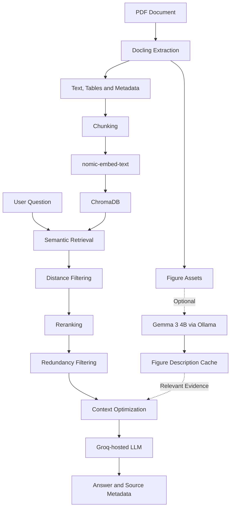

# RAG Optimization Engine
### A Multimodal PDF Question-Answering Framework with Retrieval and Context Optimization

An AI engineering and research prototype designed to answer questions about PDF documents containing text, tables, charts, diagrams, and figures. The project focuses on improving evidence selection and reducing LLM context usage through semantic retrieval, reranking, redundancy filtering, and context optimization.

**Repository:** https://github.com/SATWANIHIMANSHU/rag-optimization-engine

---

## Table of Contents

- [Overview](#overview)
- [Problem Statement](#problem-statement)
- [Objectives](#objectives)
- [Key Features](#key-features)
- [System Architecture](#system-architecture)
- [Technology Stack](#technology-stack)
- [RAG Pipeline](#rag-pipeline)
- [Project Structure](#project-structure)
- [Prerequisites](#prerequisites)
- [Installation and Setup](#installation-and-setup)
- [Configuration](#configuration)
- [Running the Application](#running-the-application)
- [Evaluation and Preliminary Results](#evaluation-and-preliminary-results)
- [Security and Privacy](#security-and-privacy)
- [Current Limitations](#current-limitations)
- [Future Enhancements](#future-enhancements)
- [Research Context](#research-context)
- [Contributing](#contributing)
- [License](#license)
- [Author](#author)

---

## Overview

Retrieval-Augmented Generation (RAG) combines information retrieval with large language models (LLMs) to generate responses grounded in external documents.

However, a conventional RAG pipeline may retrieve irrelevant or redundant passages, include unnecessary context, and consume more tokens than needed. These problems can increase inference latency and cost while potentially affecting answer quality.

The **RAG Optimization Engine** explores a modular approach to improving this process. It combines semantic retrieval with relevance-based reranking, redundancy filtering, and context optimization to select a more compact set of evidence before answer generation.

The framework also explores multimodal document processing by extracting structured content from PDFs and optionally generating descriptions of figures using a locally hosted vision-language model.

The project is intended for experimentation, evaluation, and further development of retrieval and context optimization techniques.

## Problem Statement

Traditional document question-answering systems face several challenges:

- **Irrelevant retrieval:** Semantically similar passages may not directly answer the user's question.
- **Redundant context:** Multiple retrieved chunks may contain overlapping information.
- **Unnecessary token consumption:** Large contexts can increase inference cost and processing time.
- **Multimodal document complexity:** Tables, charts, and figures may contain information that is not adequately represented by plain-text extraction alone.
- **Evaluation difficulties:** Reduced context size does not automatically guarantee improved answer quality.

This project investigates whether combining retrieval optimization techniques can reduce context usage while preserving the quality and relevance of generated answers.

## Objectives

1. Develop a PDF-based question-answering framework using Retrieval-Augmented Generation.
2. Extract and index searchable document content using document parsing and vector embeddings.
3. Improve evidence selection through semantic retrieval and reranking.
4. Reduce redundant information before sending context to the LLM.
5. Optimize context selection within a configurable token budget.
6. Explore optional figure-description generation and caching.
7. Evaluate retrieval and generation performance using reproducible experiments.
8. Investigate security requirements for authenticated, user-specific document retrieval.

## Key Features

| Feature | Description |
|---|---|
| PDF ingestion | Extract document content for indexing and retrieval. |
| Structured extraction | Process text, tables, figures, and available metadata. |
| Semantic retrieval | Retrieve candidate chunks using vector similarity. |
| Reranking | Reorder retrieved candidates based on query relevance. |
| Redundancy filtering | Reduce overlapping or repetitive evidence. |
| Context optimization | Select and arrange evidence within a context budget. |
| LLM-based answers | Generate responses using a hosted language model. |
| Optional figure analysis | Generate figure descriptions using a locally hosted vision-language model. |
| Figure-description caching | Reuse cached descriptions when valid. |
| Web application | React and Vite frontend with a FastAPI backend. |
| Authentication | JWT-based authentication and password hashing, subject to implementation verification. |
| Evaluation scripts | Compare pipeline variants and measure selected performance indicators. |

## System Architecture

The framework consists of two main workflows: offline document ingestion and online question answering.

### 1. Offline Document Ingestion

1. Accept a PDF document.
2. Extract text, tables, figures, and available metadata using Docling.
3. Convert extracted content into searchable text representations.
4. Divide the content into chunks.
5. Generate embeddings using `nomic-embed-text` through Ollama.
6. Store searchable vectors, text, and associated metadata in ChromaDB.
7. Preserve figure assets and identifiers for optional visual analysis.

### 2. Online Question Answering

1. Receive a user's question.
2. Process the query and retrieve candidate chunks.
3. Apply the configured retrieval-distance threshold.
4. Rerank the retrieved candidates.
5. Filter redundant or overlapping chunks.
6. Optimize the selected context within a token budget.
7. Send the question and selected evidence to the Groq-hosted LLM.
8. Return the generated answer with available source metadata.

### 3. Optional Figure-Analysis Workflow

1. Identify a relevant figure in the document.
2. Retrieve the corresponding image and metadata.
3. Generate a figure description using Gemma 3 4B through Ollama.
4. Cache the description for potential reuse.
5. Include the description as additional evidence when relevant.

### Architecture Diagram



*The diagram represents the intended architecture. The exact execution order and integration of each component should be confirmed against the current implementation.*

## Technology Stack

| Component | Technology | Purpose |
|---|---|---|
| Backend | Python, FastAPI | API and application logic |
| Frontend | React, Vite | User interface |
| PDF processing | Docling | Document extraction |
| Embedding model | `nomic-embed-text` via Ollama | Vector embeddings |
| Vector database | ChromaDB | Similarity search and vector storage |
| Answer generation | Groq-hosted LLM | Response generation |
| Optional vision model | Gemma 3 4B via Ollama | Figure-description generation |
| Application database | SQLite | Application data storage |
| Authentication | JWT and password hashing | Authentication mechanisms |
| Evaluation | Python scripts | Pipeline comparisons and measurements |
| Development environment | Windows, PowerShell, VS Code | Local development |

Specific model identifiers, package versions, and configuration values should be confirmed from the repository before reproducing the experiments.

## RAG Pipeline

### Semantic Retrieval

The embedding model converts document chunks and user queries into vector representations. ChromaDB retrieves candidate chunks according to the configured similarity-search method.

The current development configuration has used five initial retrieval candidates and `MAX_DISTANCE = 0.70`. These are experimental settings, not universally optimal parameters.

### Reranking

Reranking evaluates the retrieved candidates against the query and changes their ordering to prioritize more relevant evidence.

Its benefit should be measured using labeled relevance judgments rather than assumed from the presence of a reranking component.

### Redundancy Filtering

Retrieved chunks may contain repeated or overlapping information. Redundancy filtering attempts to remove unnecessary repetition while preserving complementary evidence needed to answer the question.

### Context Optimization

Context optimization selects and arranges evidence within a context budget before answer generation.

The objective is to reduce unnecessary context without removing information required for an accurate answer. Both context reduction and answer quality must be evaluated.

### Figure-Description Caching

The optional visual workflow uses a locally hosted vision-language model to describe figures. Caching can avoid repeated inference when a valid description already exists.

Cache invalidation, document updates, cache-hit rates, and cache-miss latency require separate verification.

## Project Structure

The repository contains backend, frontend, GPU-service, and evaluation components. The following is a simplified logical overview; confirm exact filenames and entry points against the current repository.

```text
rag-optimization-engine/
├── backend/
│   ├── app/
│   │   ├── main.py
│   │   ├── rag_pipeline.py
│   │   ├── vector_store.py
│   │   └── ...
│   └── requirements.txt
├── frontend/
│   ├── src/
│   ├── package.json
│   └── vite.config.js
├── gpu_service/
│   └── visual_service.py
├── benchmark_rag_latency_repeated.py
├── compare_baseline_vs_optimized.py
├── evaluate_intermediate_pipelines.py
├── export_context_precision_labels.py
├── make_context_precision_candidates.py
├── prepare_context_review.py
├── .gitignore
└── README.md
```

Additional modules and evaluation scripts may exist in the repository.

## Prerequisites

Before running the project, ensure that you have the required software and credentials:

- Python compatible with the project's dependencies.
- Node.js and npm.
- Ollama installed and running.
- The `nomic-embed-text` embedding model available through Ollama.
- Gemma 3 4B available through Ollama if using the optional figure-analysis workflow.
- A Groq API key for hosted answer generation.
- Access to the project dependencies listed in `backend/requirements.txt` and `frontend/package.json`.

Exact version requirements should be taken from the project's configuration files.

## Installation and Setup

The following commands are intended for Windows PowerShell. Confirm the actual application entry points and required configuration before running the services.

### 1. Clone the Repository

```powershell
git clone https://github.com/SATWANIHIMANSHU/rag-optimization-engine.git
cd rag-optimization-engine
```

### 2. Create a Python Virtual Environment

```powershell
python -m venv .venv
.\.venv\Scripts\Activate.ps1
```

If PowerShell prevents activation, use an appropriate execution-policy setting for your environment rather than disabling security protections globally.

### 3. Install Backend Dependencies

```powershell
pip install -r backend/requirements.txt
```

### 4. Configure Ollama

Install Ollama, start the service, and download the embedding model:

```powershell
ollama pull nomic-embed-text
```

For optional figure analysis:

```powershell
ollama pull gemma3:4b
```

The exact Ollama model tag must match the identifier configured in the project.

### 5. Configure Environment Variables

Create a local `.env` file if the application expects one. Use the variable names required by the source code.

Example placeholders:

```dotenv
GROQ_API_KEY=your_groq_api_key
JWT_SECRET_KEY=your_long_random_secret
```

These are illustrative names. Verify the actual environment-variable names in the implementation before using this example.

**Never commit `.env` files, API keys, JWT secrets, or other credentials to GitHub.**

### 6. Install Frontend Dependencies

```powershell
cd frontend
npm install
cd ..
```

Use the committed lockfile when installing dependencies to improve reproducibility.

## Configuration

The system may expose configuration for:

- Embedding and answer-generation models.
- Initial retrieval candidate count.
- Retrieval-distance thresholds.
- Reranking and redundancy filtering.
- Context token budgets.
- Figure-description caching.
- Database and vector-store locations.
- Authentication and API credentials.

Review the existing source code and environment configuration to identify the actual supported settings. Do not assume every listed option is currently configurable through environment variables.

## Running the Application

The commands below are examples of common development workflows. Verify the actual FastAPI and frontend entry points before using them.

### Backend

From the project root, activate the virtual environment and run the configured FastAPI application. If `backend/app/main.py` exposes the application as `app`, the following may work:

```powershell
python -m uvicorn backend.app.main:app --reload
```

If the project expects the `backend` directory as the working directory, the import path may differ.

### Frontend

```powershell
cd frontend
npm run dev
```

Vite prints the local development URL when the server starts.

For the application to work end to end, confirm that the frontend API base URL matches the running backend and that all required services and environment variables are configured.

## Evaluation and Preliminary Results

The project includes experimental comparisons of multiple RAG pipeline configurations.

The following results were recorded during development. They are **preliminary observations from a small demonstration set**, not validated evidence of general performance.

### Preliminary Pipeline Comparison

| Pipeline | Keyword matches | Average tokens | Median latency |
|---|---:|---:|---:|
| Baseline RAG | 9/10 | 568.8 | 0.68 s |
| RAG with reranking | 10/10 | 568.8 | 3.71 s |
| Reranking + redundancy filtering | 10/10 | 577.1 | 3.46 s |
| Full optimized RAG | 10/10 | 256.4 | 4.40 s |

*The full optimized RAG latency was recorded as 4.53 seconds in an earlier run. The values should be reconciled using consistent benchmark runs before being treated as final results.*

### Preliminary Observations

- The full optimized configuration used approximately 55% fewer context tokens than the baseline in the recorded experiment.
- Keyword matches increased from 9/10 to 10/10 in the tested optimized configurations.
- Reranking increased recorded latency compared with the baseline.
- Redundancy filtering did not reduce average context tokens in this particular experiment.
- The full pipeline's lower context usage did not correspond to lower end-to-end latency in the recorded results.

These observations illustrate trade-offs between context efficiency and processing time. They do not establish statistical significance or prove that the optimized pipeline performs better on general workloads.

### Additional Development Observations

- Table questions: 6/6 correct in the recorded demonstration.
- Figure questions: 2/3 for baseline and 3/3 for the optimized variants.
- One uncached figure-analysis run took approximately 136 seconds.
- A subsequent cached standalone analysis took approximately 0.75 seconds.

These are small-sample or individual-run observations, not controlled averages.

### Evaluation Requirements

Future benchmark reports should include:

1. A fixed, documented evaluation dataset.
2. Human-reviewed relevance labels for retrieved chunks.
3. Retrieval metrics such as Precision@k, Recall@k, and MRR where appropriate.
4. Answer-quality evaluation beyond keyword matching.
5. Context-token measurements using a consistent counting method.
6. Repeated latency measurements, including median and tail latency.
7. Separate cache-hit and cache-miss measurements.
8. Documented hardware, model versions, and configuration.
9. Ablation experiments isolating the contribution of each optimization.

Context-precision estimates should remain provisional until supported by appropriate relevance annotations and a documented evaluation method.

## Security and Privacy

Security and reliability are important areas of ongoing development.

Key requirements include:

- Store API keys and authentication secrets outside source control.
- Validate uploaded PDF files, file names, sizes, and storage paths.
- Verify that users cannot retrieve documents or chunks belonging to other users.
- Test access control across every retrieval and query path.
- Avoid exposing sensitive document content through logs or error messages.
- Invalidate stale vectors and cached figure descriptions when documents change.
- Document which processing occurs locally and which content is sent to hosted services.

Although the architecture includes authentication components, complete user-level vector isolation has not been verified. The application should not be considered production-ready until the relevant security, reliability, and isolation tests pass.

### Data Processing Considerations

Ollama-hosted models run locally in the configured environment. However, answer generation through a hosted Groq model involves sending the information included in the generation request to that service.

Review the applicable provider policies and ensure that document content is appropriate to process through external services.

## Current Limitations

- Preliminary evaluation uses a small demonstration set.
- Keyword matching is not a complete measure of answer correctness.
- Retrieval relevance annotations require further validation.
- Performance results need consistent, repeatable benchmarking.
- Multimodal capabilities require broader testing across diverse documents and figures.
- Context reduction must be assessed alongside evidence coverage and answer quality.
- User-specific retrieval isolation requires explicit security testing.
- Model, dependency, and deployment configurations need to be documented for reproducibility.

These limitations define the current research scope and guide further development.

## Future Enhancements

Potential next steps include:

- Expand the evaluation dataset with human-annotated relevance judgments.
- Improve retrieval and answer-quality evaluation.
- Investigate adaptive retrieval depth and query-dependent context budgets.
- Evaluate hybrid retrieval approaches if supported by the intended architecture.
- Improve figure and table grounding and source attribution.
- Measure cache invalidation and cache performance systematically.
- Implement and verify strict user-level document and vector isolation.
- Add automated tests and reproducible benchmark commands.
- Document deployment, monitoring, and operational requirements.

These are proposed improvements, not claims about completed functionality.

## Research Context

The project draws on research areas including:

- Retrieval-Augmented Generation.
- Dense Passage Retrieval (DPR).
- ColBERT and neural reranking.
- RAPTOR and hierarchical retrieval.
- Long-context language-model behavior.
- Prompt and context compression.
- RAG evaluation frameworks such as RAGAS.
- Multimodal document processing and retrieval.

These works provide background and comparison points. Their inclusion in the research context does not imply that the project implements their algorithms.

Research references, publication details, and citations should be verified before being used in a conference submission.

## Contributing

Contributions and technical feedback are welcome.

Suggested areas include retrieval evaluation, context optimization, multimodal document processing, reproducibility, and security testing.

For substantial changes:

1. Describe the problem and intended behavior.
2. Explain the proposed implementation.
3. Include tests or reproducible evaluation results where appropriate.
4. Document changes to configuration and dependencies.
5. Avoid including credentials, private documents, or generated artifacts unnecessarily.

## License

A license has not yet been specified. Add a license file after choosing the appropriate terms for this project.

Until then, do not assume that the repository grants permission to reuse, modify, or redistribute its contents.

## Author

**Himanshu Satwani**

- GitHub: https://github.com/SATWANIHIMANSHU
- Project: https://github.com/SATWANIHIMANSHU/rag-optimization-engine

---

*This project is an evolving AI engineering and research prototype. Features, configurations, and experimental results should be verified against the current implementation before drawing conclusions or reproducing results.*
